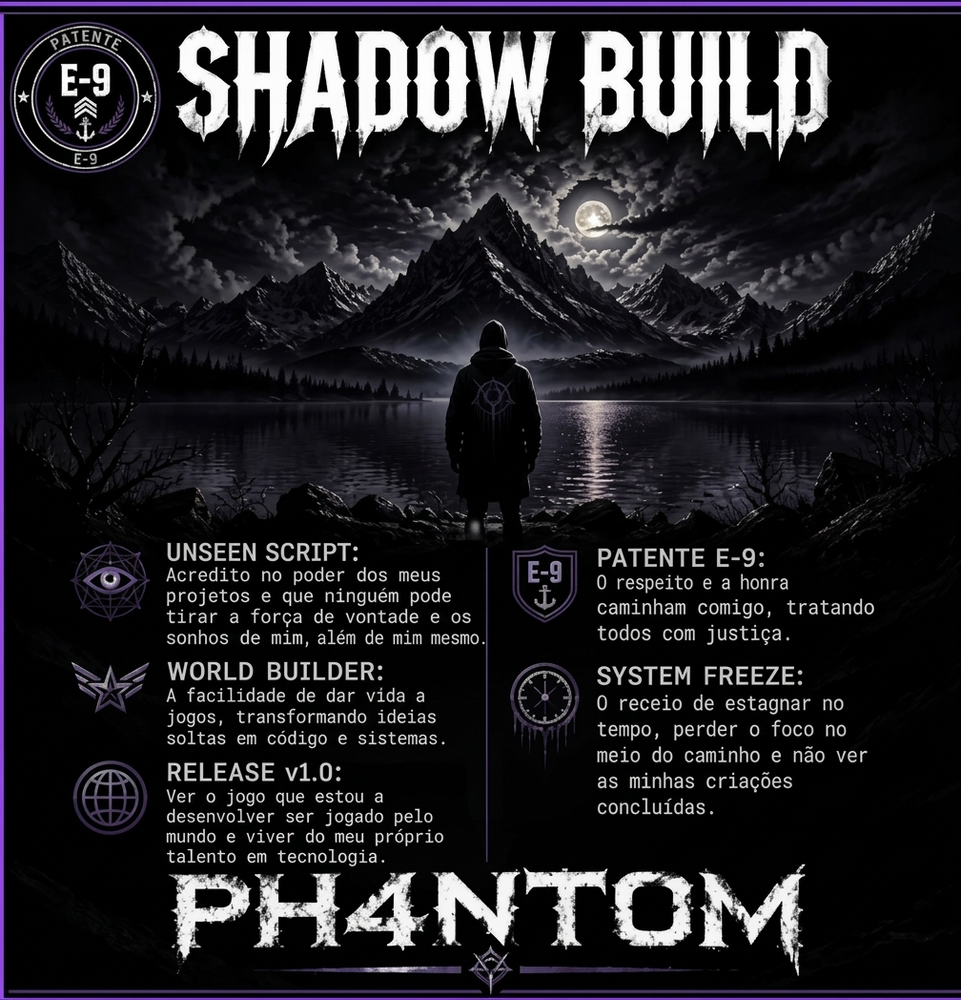

# Capa do Meu Álbum — SHADOW BUILD

Projeto de identidade visual de Pedro Gabriel. A capa apresenta o artista **PH4NT0M** e o selo **Patente E-9**, conectando referências visuais, valores pessoais e criação de jogos.

## Materiais

- [Processo de criação](PROCESSO.md): conceito, paleta, prompt e direção de arte.
- [Tracklist](tracklist.md): as cinco faixas e seus significados.
- [Projeto no Canva](https://canva.link/022ulc2po42sbmz).

## Navegação

[Voltar ao portfólio](https://pgbbranco.github.io/portfolio/) · [Outros repositórios](https://github.com/pgbbranco)
