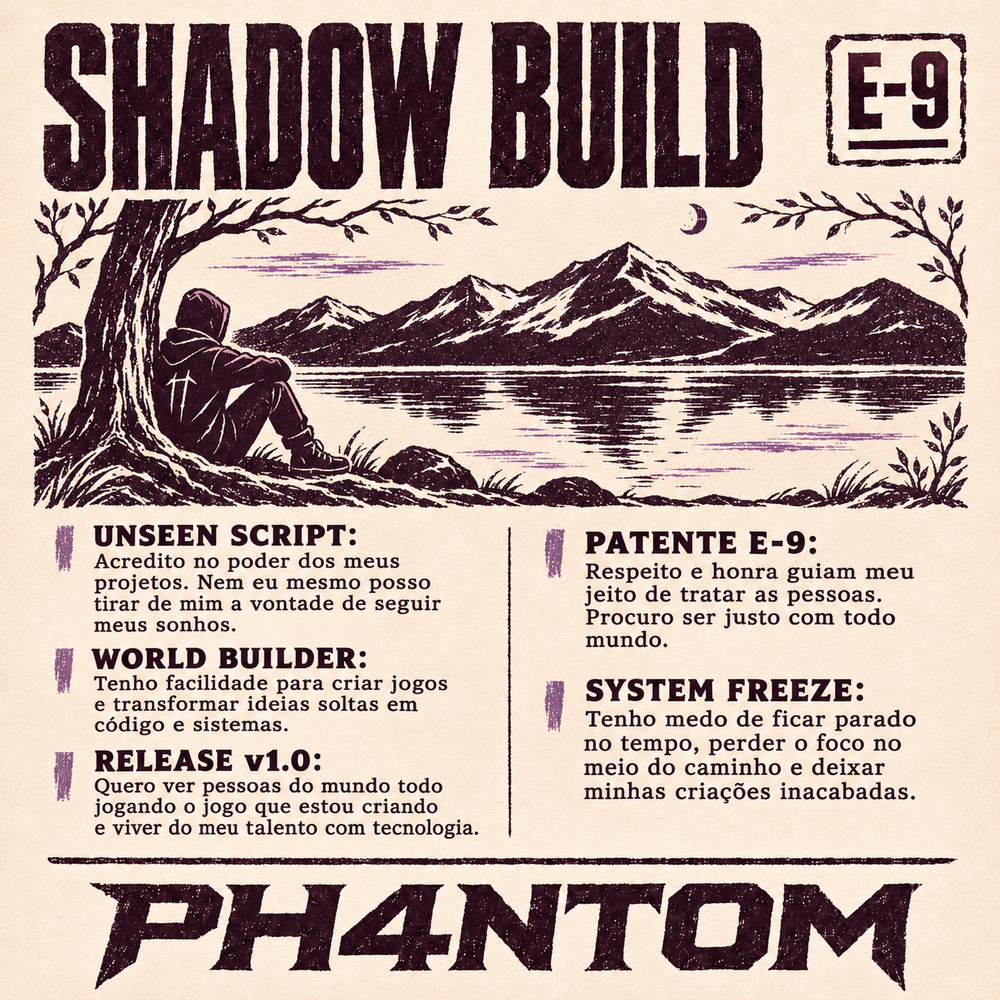

# Capa do Meu Álbum — SHADOW BUILD

Este repositório reúne a capa que criei para o álbum SHADOW BUILD, o processo de criação da identidade visual de PH4NT0M e a lista das cinco faixas com seus significados.

[Explorar os materiais do projeto](capa-do-album/README.md) · [Voltar ao portfólio](https://pgbbranco.github.io/portfolio/)
